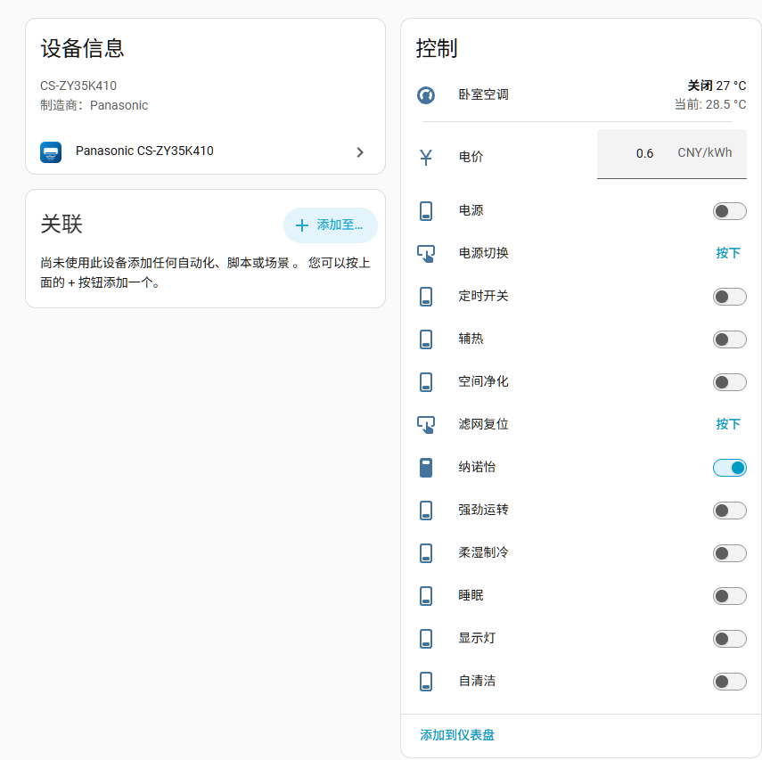
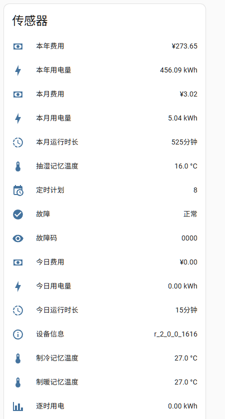

# 松下 CS-ZY35K410 专用集成

非官方 Home Assistant 集成，通过松下中国智能家电云（`app.psmartcloud.com`）接入 **CS-ZY35K410** 壁挂空调。

**只支持这一个型号**——代码里没有其它机型、控制器或旧协议的兼容分支，配置时也只认 `0900 / CS-ZY35K410` 这一种设备，多设备账号下其余空调不会出现在选择列表里。

**34 个实体（默认启用 30 个）**，支持：完整空调控制、电量与电费统计、逐时用电曲线、指示灯与纳诺怡等九路功能开关、定时计划、故障诊断。

## 界面

控制面板：设备信息、电价、电源与各项功能开关。

传感器：用电量 / 费用 / 运行时长、记忆温度、定时计划、故障与设备信息。

## 功能

### 空调控制

- **模式**：自动 / 制冷 / 制暖 / 抽湿 / 送风
- **温度**：16–30 ℃，步长 1.0 ℃（本机 `tempType=0`）
- **风速**：6 档（自动 / 最小 / 低 / 中 / 高 / 最大）
- **扫风**：上下 6 档（Auto、Up、Up Middle、Middle、Down Middle、Down）、左右 6 档（Auto、Left、Left Middle、Center、Right Middle、Right）
- **按钮**：电源切换、滤网复位
- **电价**：元/kWh，可直接在 HA 里改并写回云端，云端据此计算费用

### 电量统计

- 今日 / 本月 / 本年：用电量（kWh）、费用（¥）、运行时长（分钟）
- **逐时用电**：24 点数组，可直接接 `statistics-graph` 或 apexcharts 画曲线
- 本月每日电量与费用、30 天曲线、记忆风速等明细，作为属性挂在对应实体上，不额外占用实体
- 电量为 `total_increasing`，可直接进 HA 能源面板

### 功能开关（均由 `*Ex` 能力位门控）

强劲运转、自清洁、柔湿制冷、辅热、纳诺怡、睡眠、**显示灯**、空间净化、**定时开关**。

- 显示灯为反向字段（`lamp=0` 表示灯亮），集成已做反转，实体 `on` 就是灯亮
- 定时开关控制云端「定时计划」是否生效；计划内容本身只读（见已知限制）

### 诊断与信息

- **故障**（二进制传感器）+ **故障码**：`0000` 正常、`07DF` 碰撞开关异常、`OFFLINE` 本体离线
- **定时计划**：显示已配置的组数（如 8），完整周计划作为属性
- **设备信息**：固件版本（如 `r_2_0_0_1616`），另有 OTA 进度、主账号、帮助错误信息等属性
- **记忆温度**：制冷 / 制暖 / 抽湿三个模式各自记住的设定温度

## 实体清单（34 个定义，默认启用 30 个）

| 平台 | 数量 | 实体 |
|---|---|---|
| `climate` | 1 | 空调 |
| `switch` | 10 | 电源、强劲运转、自清洁、柔湿制冷、辅热、纳诺怡、睡眠、显示灯、空间净化、定时开关 |
| `sensor` | 16 | 故障码、今日用电量 / 时长 / 费用、本月用电量 / 时长 / 费用、本年用电量 / 费用、制冷 / 制暖 / 抽湿记忆温度、定时计划、逐时用电、设备信息、~~回风温度~~ |
| `binary_sensor` | 2 | 故障、~~滤网需更换~~ |
| `button` | 2 | 电源切换、滤网复位 |
| `number` | 1 | 电价 |
| `select` | 2 | ~~上下扫风位置~~、~~左右扫风位置~~ |

划线项默认禁用（`disabled_by: integration`），需要时在「设置 → 设备与服务 → 实体 → 筛选已禁用」里手动启用，位置数据是现成的，启用即有值：

- **回风温度**：本机 `inhaleTemperature` 恒为哨兵值 `128`，没有真实回风温度可报
- **滤网需更换**：`filterReset` 在协议里是一次性复位指令而非状态位，本机 `airconType=0` 也不会触发 App 的滤网提醒
- **上下 / 左右扫风位置**：与空调卡的两个摆动下拉写同一对字段，属重复入口，保留作备用

## 安装

HACS：添加本仓库为自定义仓库（类别 Integration）→ 搜索 `Panasonic CS-ZY35K410` → 下载 → 重启 HA。

手动：复制 `custom_components/panasonic_smart_china_zy` 到 `/config/custom_components/`，重启后添加集成。

集成名称与图标全部为本地 PNG，不依赖在线资源：`brand/icon.png`（512×512，集成列表方图）、`brand/logo.png`（1024×384，详情页横幅），根目录同名文件用于兼容 2024.11 之前的 HA。

## 配置

1. 设置 → 设备与服务 → 添加集成 → 搜索 `Panasonic CS-ZY35K410`
2. 输入松下智能家电 App 的**手机号 / 邮箱 + 密码**（与官方 App 同一账号）
3. 集成自动拉取设备列表，只显示本型号；选中后自动推导 token 并创建条目

> 松下账号是**单点登录**：HA 登录后手机 App 会掉线，手机重新登录又会让 HA 会话失效。会话过期时 HA 会提示「重新登录松下账号」，重新输密码即可，设备 ID 与已有实体 ID 都不变。

## 已知限制

| 项 | 说明 |
|---|---|
| 风感场景（怡静 / 超远 / 环抱） | **本机型不支持**：状态报文无 `scene` 字段、无 `sceneEx` 能力位 |
| 定时计划编辑 | 只读。写入需要 `ACSetAirconTimerNewProtocol` 并按能力位裁剪字段，写错会静默改掉 App 里的日程，故不开放 |
| 回风温度 | 本机不上报，恒为哨兵 `128` |
| 滤网提醒 | 本机 `airconType=0`，无有效状态位 |
| 摆动档位显示英文 | HA 前端只翻译内置值（off / vertical / horizontal / both），自定义档位原样显示；改成中文会改变 state 值，影响历史与自动化 |
| 温度步长 | 固定 1.0 ℃。协议 `tempType=1` 才支持 0.5 ℃，本机为 0 |

## 数据来源

状态与控制走 `ACDevGetStatusInfoAW` / `ACDevSetStatusNewProtocol`（单字段增量写入，不覆盖其它参数）；另有电量、电价、模式温度、定时、固件等只读端点。所有字段语义均对照官方 AirconCommon H5 包并在实机（2026-11-06）校准，非官方文档。云端接口变更可能导致集成失效，届时需跟随官方 App 更新。

## 说明

- 本项目与松下无关联，仅供自用与学习
- 许可证：MIT
